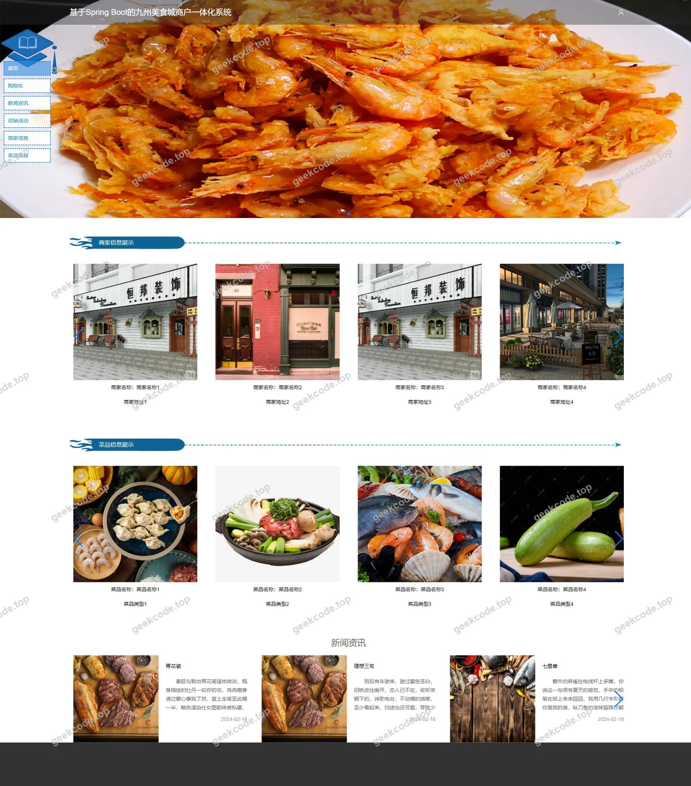
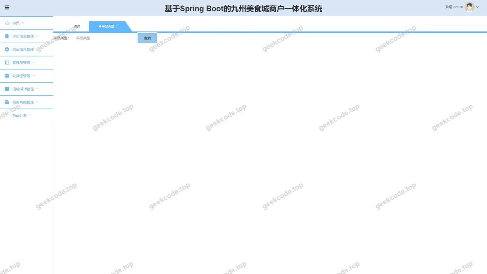
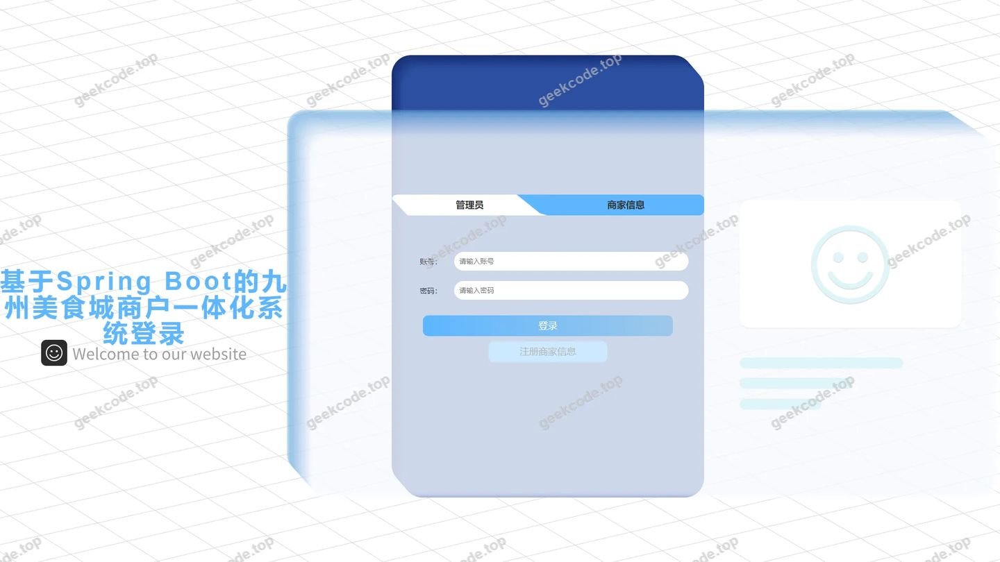
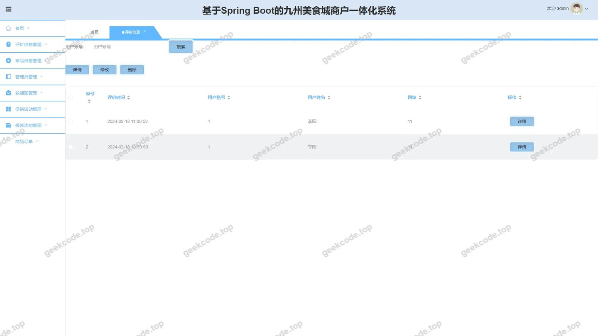
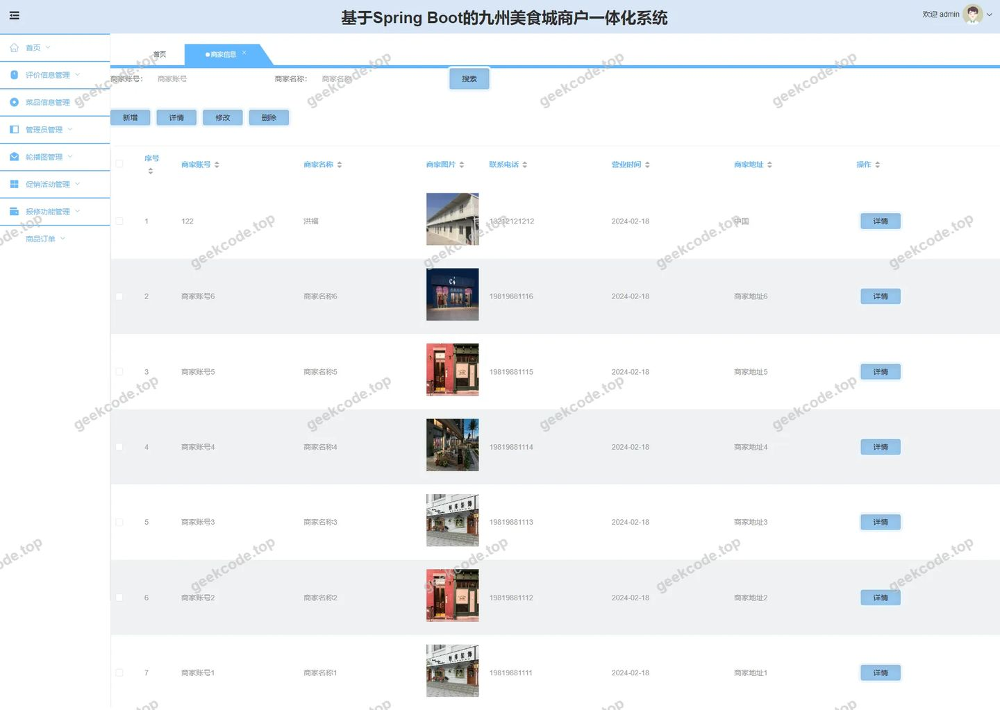
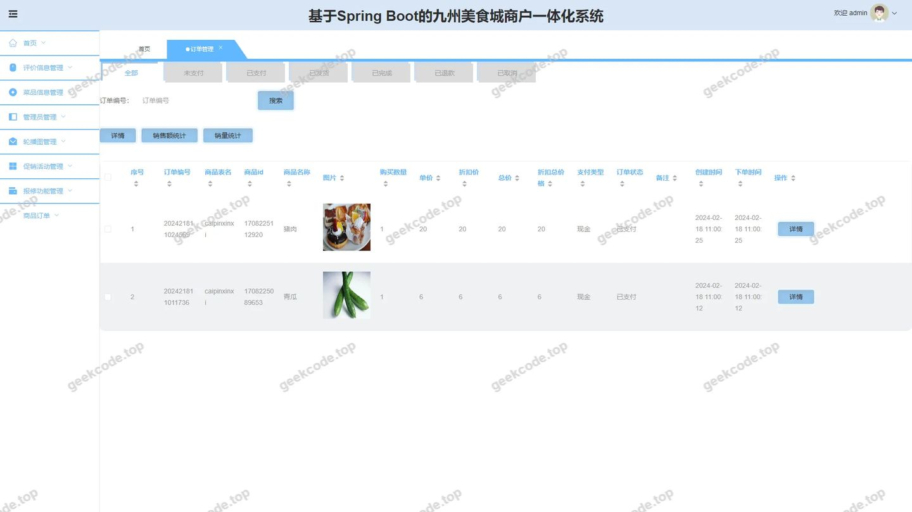
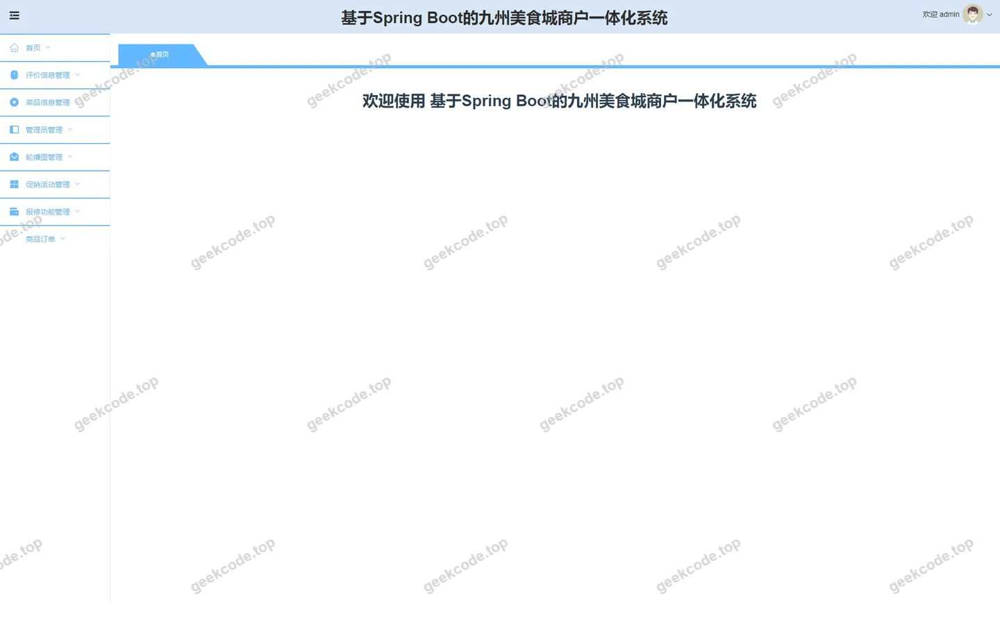
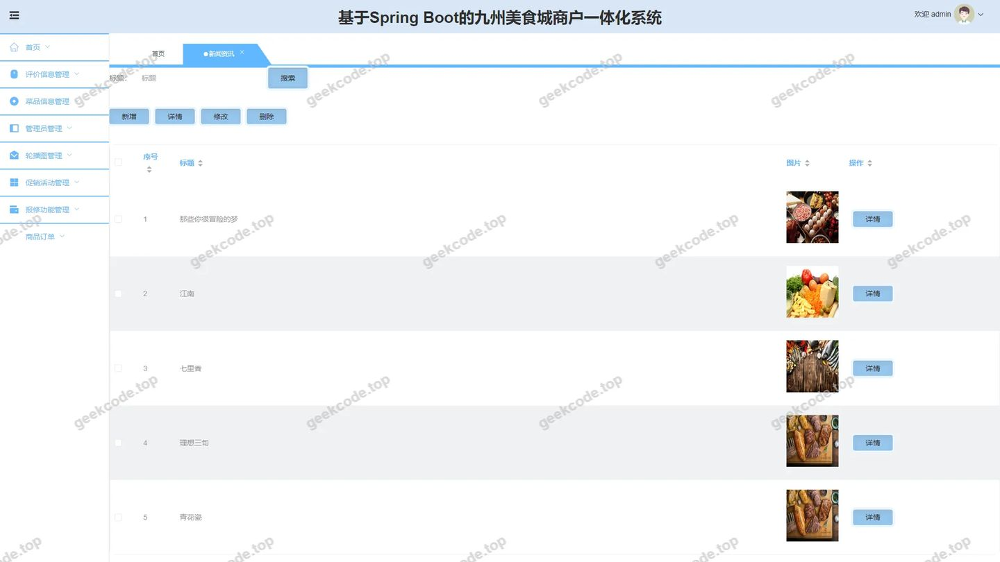
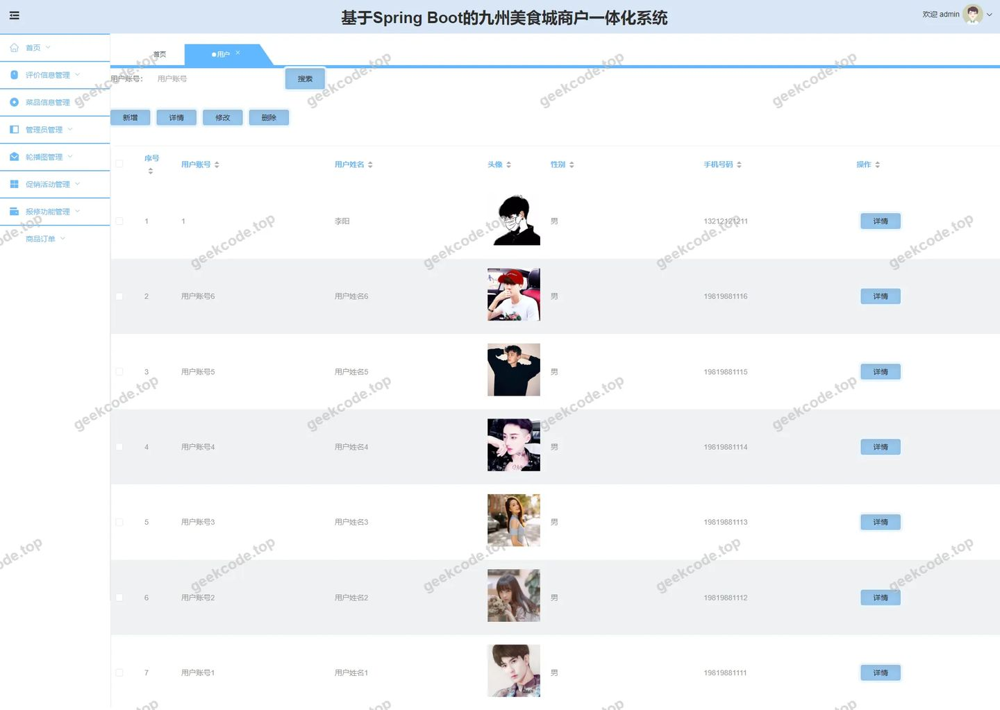

# 基于Spring Boot的九州美食城商户一体化系统

> 🎓 **计算机毕业设计 · 基于Spring Boot的九州美食城商户一体化系统**
>
> 本仓库只放**项目介绍 + 运行截图**（截图是站点带水印的原图，存在仓库 `images/` 里）。
>
> 👉 **完整可运行源码 / 数据库脚本 / 部署文档：[点我获取](https://geekcode.top/archives/%E5%9F%BA%E4%BA%8ESpring-Boot%E7%9A%84%E4%B9%9D%E5%B7%9E%E7%BE%8E%E9%A3%9F%E5%9F%8E%E5%95%86%E6%88%B7%E4%B8%80%E4%BD%93%E5%8C%96%E7%B3%BB%E7%BB%9F?utm_source=github)**
>
> 💬 咨询微信：**ir9372**　|　🌐 更多项目：[极客代码 geekcode.top](https://geekcode.top/?utm_source=github)
>
> 📌 项目详情页：<https://geekcode.top/archives/%E5%9F%BA%E4%BA%8ESpring-Boot%E7%9A%84%E4%B9%9D%E5%B7%9E%E7%BE%8E%E9%A3%9F%E5%9F%8E%E5%95%86%E6%88%B7%E4%B8%80%E4%BD%93%E5%8C%96%E7%B3%BB%E7%BB%9F?utm_source=github>

<table><td width="230" align="center"> <b>扫码加微信 ir9372</b></td><td valign="middle">📦 源码 = 项目介绍 + 全部运行截图 + 数据库 + 部署文档 👉 点上方任意截图，直接跳到 <b>极客代码 geekcode.top</b> 详情页</td></table>

---

<h1>基于Spring Boot的九州美食城商户一体化系统</h1>
<h2>项目概述</h2>

本项目名为“基于Spring Boot的九州美食城商户一体化系统”，旨在构建一个集商家入驻、菜品展示、在线点餐、订单管理及用户评价于一体的综合性餐饮服务平台。系统采用前后端分离架构，服务于普通消费者与后台管理人员两大群体。前台提供首页浏览、商家信息查询、菜品分类展示、购物车管理、订单确认及个人中心等功能；后台则涵盖用户管理、商家信息管理、菜品类型维护、订单处理、新闻资讯发布、促销活动配置及评价审核等核心业务模块。通过该系统的实施，能够有效解决传统餐饮信息分散、管理效率低下及用户反馈渠道不畅等问题，实现商户运营数字化与用户体验标准化的统一，适用于中小型美食广场或独立餐饮商户的日常经营管理场景。

<h2>技术架构</h2>

本系统采用经典的前后端分离开发模式，确保系统的高内聚低耦合特性。

<strong>后端架构：</strong>
基于 Spring Boot 框架构建核心服务端，利用其自动配置和起步依赖特性简化开发流程。数据持久层选用 MyBatis-Plus 作为 ORM 框架，结合 MySQL 数据库进行数据存储与管理，MyBatis-Plus 提供了强大的 CRUD 操作封装及分页插件支持，显著提升了开发效率。安全控制方面集成 Apache Shiro 框架，负责系统的身份认证（Authentication）与授权（Authorization），保障接口访问的安全性。通信协议主要采用 HTTP/HTTPS，数据交换格式为 JSON。

<strong>前端架构：</strong>
前端界面基于 Vue.js 生态体系构建（根据项目类型 vue-integrated 推断），通过 Axios 等库与后端 API 进行异步交互。路由管理采用 Vue Router，实现单页面应用（SPA）的高效导航。UI 组件库根据截图风格推测采用了常见的企业级 UI 框架（如 Element UI 或类似组件库），以提供一致的视觉体验和丰富的交互组件。

<strong>数据库设计要点：</strong>
数据库遵循第三范式进行设计，主要实体包括用户表、商家信息表、菜品信息表、菜品类型表、订单表、评价信息表、促销活动和新闻表等。各表之间通过外键或逻辑关联建立联系，例如订单表关联用户与菜品信息，评价表关联订单与用户，确保数据的一致性与完整性。

<h2>功能模块</h2>
<h3>前台用户端功能</h3>
<ol>
<li><strong>首页与资讯浏览</strong>：展示平台最新动态、推荐商家及热门菜品，提供新闻列表查看入口。</li>
<li><strong>用户注册与登录</strong>：新用户可通过填写基本信息完成注册，老用户可凭账号密码登录系统。</li>
<li><strong>商家信息管理</strong>：用户可查看商家详细信息列表及详情页，支持新增商家信息（针对特定角色或测试需求）。</li>
<li><strong>菜品浏览与搜索</strong>：按菜品类型分类展示菜品列表，查看菜品详情，支持添加菜品信息（视权限而定）。</li>
<li><strong>购物车与下单</strong>：用户可将心仪菜品加入购物车，在订单确认页核对信息并提交订单。</li>
<li><strong>订单管理</strong>：查看个人历史订单列表及订单状态。</li>
<li><strong>评价系统</strong>：用户对已完成的订单或商家进行评价，查看评价详情及列表。</li>
<li><strong>促销活动参与</strong>：浏览当前进行的促销活动列表及详情。</li>
<li><strong>个人中心</strong>：查看个人信息，管理账户设置，查看维修功能相关记录（若适用）。</li>
</ol>
<h3>后台管理端功能</h3>
<ol>
<li><strong>系统首页</strong>：管理员登录后的默认工作台，展示关键数据统计或快捷入口。</li>
<li><strong>用户管理</strong>：对平台注册用户进行增删改查操作，管理用户状态。</li>
<li><strong>商家信息管理</strong>：审核、编辑、删除商家入驻信息及资料。</li>
<li><strong>菜品类型管理</strong>：定义和维护菜品的分类标签，便于前台筛选。</li>
<li><strong>菜品信息管理</strong>：上架、下架、编辑具体菜品详情，关联菜品类型。</li>
<li><strong>订单管理</strong>：查看所有用户提交的订单，处理订单状态变更（如发货、退款等）。</li>
<li><strong>评价信息管理</strong>：监控和管理用户提交的评价内容，进行合规性审查。</li>
<li><strong>新闻资讯管理</strong>：发布、编辑或删除平台公告及新闻文章。</li>
<li><strong>促销活动管理</strong>：配置限时折扣、满减等营销活动规则。</li>
<li><strong>系统配置管理</strong>：维护网站基础参数及全局配置项。</li>
<li><strong>维修功能管理</strong>：针对设备或设施报修信息的后台处理模块。</li>
<li><strong>用户中心/注册管理</strong>：后台侧的用户注册审核或特殊账号创建入口。</li>
</ol>
<h2>用户角色与权限</h2>

根据系统路由及功能划分，主要存在以下两类角色：

<strong>1. 普通用户（消费者）</strong>

<ul>
<li><strong>访问范围</strong>：仅限前台路由。</li>
<li><strong>核心权限</strong>：</li>
<li>浏览首页、新闻、商家列表、菜品列表及促销活动。</li>
<li>注册新账号并登录。</li>
<li>查看个人信息（个人中心）。</li>
<li>执行交易操作：加入购物车、确认订单、提交订单。</li>
<li>内容贡献：发表评价信息。</li>
<li><em>注：部分前台路由如 <code>/index/shangjiaxinxiAdd</code> 和 <code>/index/caipinxinxiAdd</code> 通常不对普通开放，除非具备商家资质，但依据现有菜单结构，普通用户主要聚焦于消费与互动环节。</em></li>
</ul>

<strong>2. 系统管理员</strong>

<ul>
<li><strong>访问范围</strong>：仅限后台路由。</li>
<li><strong>核心权限</strong>：</li>
<li><strong>全量数据管理</strong>：拥有对用户 (<code>/yonghu</code>)、商家信息 (<code>/shangjiaxinxi</code>)、菜品信息 (<code>/caipinxinxi</code>)、菜品类型 (<code>/caipinleixing</code>) 的新增、修改、删除和查询权限。</li>
<li><strong>业务运营支持</strong>：管理订单 (<code>/orders</code>) 状态，审核和处理评价信息 (<code>/pingjiaxinxi</code>)，发布与维护新闻资讯 (<code>/news</code>)，配置促销活动 (<code>/cuxiaohuodong</code>)。</li>
<li><strong>系统维护</strong>：访问系统配置 (<code>/config</code>)，管理后台用户账户 (<code>/users</code>)，处理维修功能请求 (<code>/baoxiugongneng</code>)。</li>
<li><strong>商家入驻辅助</strong>：通过 <code>/shangjiaxinxiCenter</code> 或 <code>/shangjiaxinxiRegister</code> 协助或审核商家注册流程。</li>
</ul>
<h2>项目特色与创新点</h2>
<ol>
<li><strong>商户一体化闭环</strong>：系统将商家入驻、菜品管理、订单履约到用户评价形成完整业务闭环，避免了传统模式下各环节数据孤岛的问题，提升了商户运营效率。</li>
<li><strong>灵活的角色权限体系</strong>：基于 Shiro 实现了细粒度的权限控制，区分了前台消费者的体验视角与后台管理员的管理视角，保障了数据安全与操作规范。</li>
<li><strong>模块化功能扩展</strong>：设计了独立的“维修功能”模块 (<code>/baoxiugongneng</code>)，这在一般外卖系统中较为少见，体现了对线下实体店铺设施维护需求的关注，增强了系统的实用性。</li>
<li><strong>动态营销支持</strong>：内置促销活动管理模块，允许后台快速配置和调整营销策略，帮助商户提升销售额和用户活跃度。</li>
<li><strong>技术选型稳健</strong>：采用 Spring Boot + MyBatis-Plus + Vue 的主流技术栈，保证了系统的高可维护性、高性能以及良好的社区支持，适合毕业设计向实际生产环境过渡的需求。</li>
</ol>
<h2>部署环境</h2>

为确保系统正常运行，需准备以下软硬件环境：

<strong>硬件要求：</strong>

<ul>
<li>CPU: Intel Core i5 及以上或同等性能处理器</li>
<li>内存: 8GB 及以上</li>
<li>硬盘: 预留至少 20GB 可用空间</li>
</ul>

<strong>软件环境：</strong>

<ul>
<li><strong>操作系统</strong>: Windows 10/11, macOS 或 Linux (CentOS 7+/Ubuntu 20.04+)</li>
<li><strong>JDK</strong>: Java Development Kit 1.8 或更高版本 (建议 JDK 8)</li>
<li><strong>数据库</strong>: MySQL 5.7 或 MySQL 8.0</li>
<li><strong>Web服务器</strong>: 内置 Tomcat (由 Spring Boot 提供) 或 Nginx (用于反向代理静态资源)</li>
<li><strong>Node.js</strong>: v14.x 或 v16.x (用于前端 Vue 项目的编译与运行)</li>
<li><strong>包管理工具</strong>: Maven (用于后端依赖管理), npm 或 yarn (用于前端依赖管理)</li>
<li><strong>开发工具</strong>: IntelliJ IDEA (后端), VS Code (前端), Navicat (数据库管理)</li>
</ul>
<h2>五、技术特性</h2>
<ul>
<li>前后端集成部署，前端资源打包至后端 static 目录</li>
<li>使用 MyBatis-Plus 简化数据访问层开发</li>
<li>集成 Shiro 权限框架实现角色权限控制</li>
</ul>
<h2>六、功能模块截图</h2>
<h3>前台用户端</h3>
<h4>前台-首页</h4>

<h4>前台-登录</h4>

<h4>前台-用户注册</h4>

<h3>后台管理端</h3>
<h4>后台-菜品类型</h4>

<h4>后台-登录页</h4>

<h4>后台-评价信息</h4>

<h4>后台-商家信息</h4>

<h4>后台-订单管理</h4>

<h4>后台首页</h4>

<h4>后台-新闻资讯</h4>

<h4>后台-用户</h4>

---

## 获取完整源码

| 项目 | 说明 |
| --- | --- |
| 项目名 | 基于Spring Boot的九州美食城商户一体化系统 |
| 运行截图 | 本文 11 张（站点带水印原图，仓库 `images/` 目录） |
| 完整源码 | [https://geekcode.top/archives/%E5%9F%BA%E4%BA%8ESpring-Boot%E7%9A%84%E4%B9%9D%E5%B7%9E%E7%BE%8E%E9%A3%9F%E5%9F%8E%E5%95%86%E6%88%B7%E4%B8%80%E4%BD%93%E5%8C%96%E7%B3%BB%E7%BB%9F?utm_source=github](https://geekcode.top/archives/%E5%9F%BA%E4%BA%8ESpring-Boot%E7%9A%84%E4%B9%9D%E5%B7%9E%E7%BE%8E%E9%A3%9F%E5%9F%8E%E5%95%86%E6%88%B7%E4%B8%80%E4%BD%93%E5%8C%96%E7%B3%BB%E7%BB%9F?utm_source=github) |
| 咨询微信 | **ir9372**（备注：jingpin-yuanma） |
| 更多项目 | [极客代码 geekcode.top](https://geekcode.top/?utm_source=github) |

> 需要源码、部署、改配置、跑不起来等问题，加微信 ir9372 沟通，说明项目名即可。
